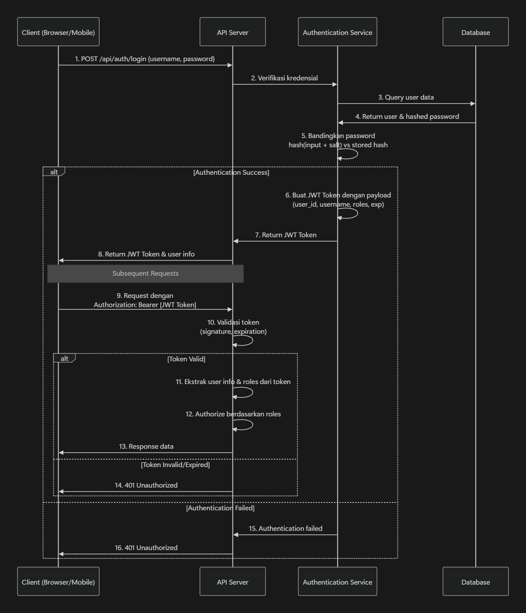
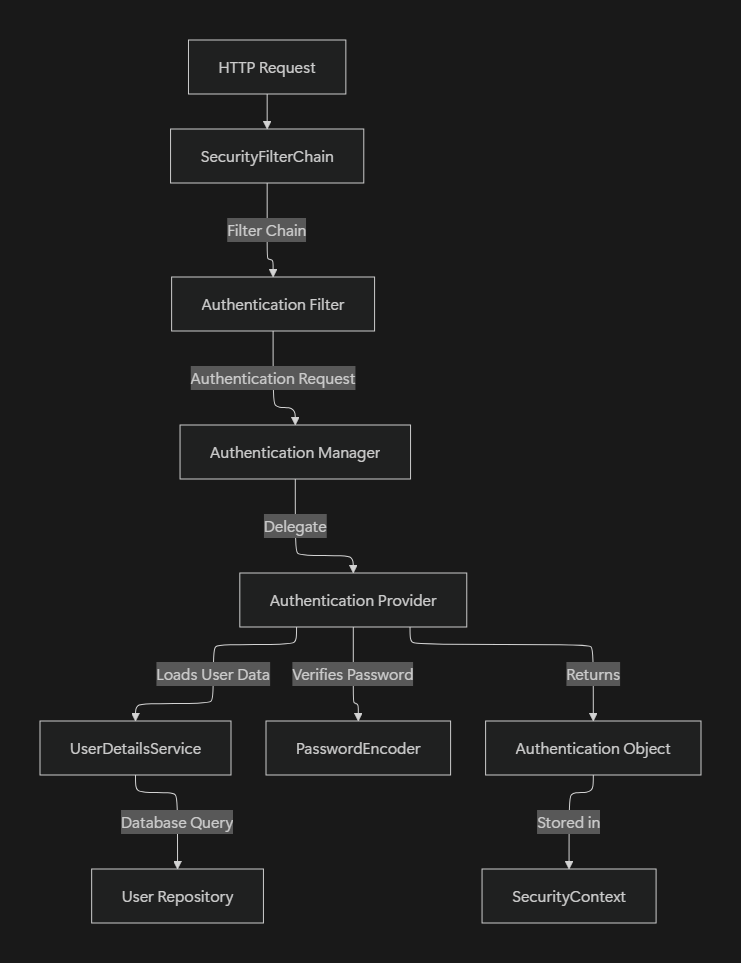
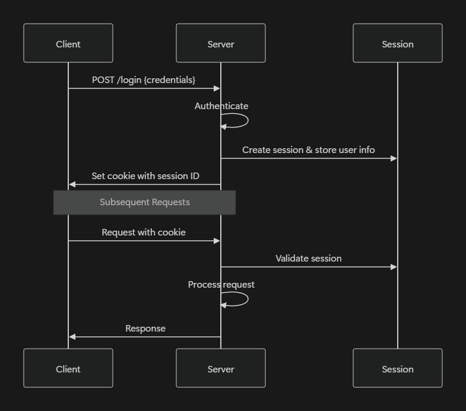
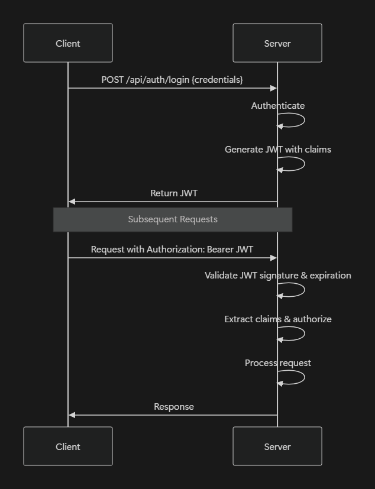

## Pengenalan

Keamanan aplikasi adalah aspek kritis dalam pengembangan perangkat lunak modern. Aplikasi yang tidak aman dapat menyebabkan kebocoran data, kerugian finansial, dan kerusakan reputasi. Sebelum kita mempelajari Spring Security secara teknis, penting untuk memahami konsep dasar keamanan aplikasi.

## Autentikasi vs Otorisasi

### Autentikasi (Authentication)

**Apa itu Autentikasi?**

Autentikasi adalah proses memverifikasi identitas seseorang atau sesuatu. Dalam konteks aplikasi web, ini berarti memastikan bahwa pengguna adalah benar-benar siapa yang mereka klaim.

**Mengapa Autentikasi Diperlukan?**

1. **Identifikasi Pengguna** - Mengetahui siapa yang menggunakan sistem
2. **Keamanan Data** - Melindungi data pengguna dari akses tidak sah
3. **Personalisasi** - Memberikan pengalaman yang disesuaikan berdasarkan profil pengguna
4. **Audit dan Logging** - Melacak siapa yang melakukan apa di dalam sistem
5. **Kepatuhan (Compliance)** - Memenuhi standar regulasi seperti GDPR, PCI DSS, dll.

**Metode Autentikasi Umum:**

1. Username/Password
2. Token-based (JWT, OAuth)
3. Biometric (sidik jari, wajah)
4. Multi-factor Authentication (MFA)
5. Single Sign-On (SSO)

### Otorisasi (Authorization)

**Apa itu Otorisasi?**

Otorisasi adalah proses menentukan apakah pengguna yang terautentikasi memiliki izin untuk melakukan tindakan atau mengakses resource tertentu.

**Mengapa Otorisasi Diperlukan?**

1. **Pembatasan Akses** - Tidak semua pengguna boleh mengakses semua data
2. **Prinsip Hak Akses Minimal** - Pengguna hanya diberi akses ke fungsi yang mereka butuhkan
3. **Data Segregation** - Memastikan pengguna hanya melihat data yang seharusnya mereka lihat
4. **Keamanan Berlapis** - Menambah lapisan perlindungan tambahan setelah autentikasi

**Metode Otorisasi Umum:**

1. Role-Based Access Control (RBAC)
2. Attribute-Based Access Control (ABAC)
3. Permission-based systems
4. Policy-based systems

### Analogi Autentikasi vs Otorisasi

Bayangkan pergi ke sebuah hotel:

- **Autentikasi** adalah proses check-in di mana resepsionis memverifikasi identitas Anda dengan memeriksa ID dan memastikan Anda memiliki reservasi.
- **Otorisasi** adalah kunci kamar yang hanya bisa membuka kamar tertentu, bukan semua kamar di hotel.

## Evolusi Keamanan Password

### 1. Password Plaintext (Penyimpanan dan Pencocokan)

**Apa itu?**

Password disimpan apa adanya (plaintext) dalam database.

**Contoh:**

```text
Database: password = "rahasia123"
Login Input: "rahasia123"
Verifikasi: input === database ? Success : Fail
```

**Mengapa Buruk?**

Jika database dibobol, semua password pengguna langsung terekspos. Admin dan teknisi database juga bisa melihat semua password.

**Analogi:**

Seperti menyimpan kunci rumah di bawah keset. Siapapun yang menemukan keset dapat langsung masuk.

### 2. Password Terenkripsi (Encrypt/Decrypt)

**Apa itu?**

Password dienkripsi sebelum disimpan ke database dan didekripsi saat verifikasi.

**Contoh:**
```text
Password asli: "rahasia123"
Password terenkripsi: "xD4f2vB7q9"
Proses verifikasi: encrypt(input) === database ? Success : Fail
ATAU decrypt(database) === input ? Success : Fail
```

**Mengapa Masih Kurang Aman?**

Dengan kunci enkripsi yang sama, password masih bisa didekripsi ke bentuk aslinya. Jika kunci enkripsi bocor, semua password bisa terekspos.

**Analogi:**

Seperti menyimpan kunci rumah dalam kotak terkunci. Masih ada kunci master untuk kotak tersebut yang bisa membuka semua kunci rumah.

### 3. Password Hashing Tanpa Salt

**Apa itu?**

Password diproses melalui fungsi hash yang mengubahnya menjadi string fixed-length dan satu arah (tidak bisa dikembalikan ke bentuk asli).

**Contoh:**

```text
Password asli: "rahasia123"
Hash: MD5("rahasia123") = "c5e3539121c4944f2bbe097b425ee774"
Verifikasi: hash(input) === database ? Success : Fail
```

**Mengapa Lebih Baik?**

Hash tidak bisa dibalik (one-way function). Jika database dibobol, penyerang hanya mendapatkan hash, bukan password asli.

**Mengapa Masih Ada Kelemahan?**

Rentan terhadap rainbow table attacks dan dictionary attacks. Hash yang sama untuk password yang sama membuatnya rentan terhadap pattern recognition.

**Analogi:**

Seperti mengubah kunci fisik menjadi foto kunci. Penyerang tidak bisa menggunakan foto untuk membuka pintu, tapi bisa membuat kunci baru dari foto jika punya akses ke mesin pembuat kunci dan katalog kunci.

### 4. Password Hashing Dengan Salt

**Apa itu?**

Salt adalah string random yang ditambahkan ke password sebelum dihashing. Setiap pengguna memiliki salt unik.

**Contoh:**

```text
Password asli: "rahasia123"
Salt: "a1b2c3d4" (random untuk setiap pengguna)
Hash: bcrypt("rahasia123" + "a1b2c3d4") = "$2a$10$a1b2c3d4.x8zE9jkLM3p4e6PSBfH"
Simpan: Salt + Hash
Verifikasi: hash(input + salt) === database ? Success : Fail
```

**Mengapa Aman?**

- Salt yang unik untuk setiap pengguna mencegah rainbow table attacks
- Meskipun dua pengguna memiliki password sama, hash yang disimpan berbeda
- Algoritma seperti bcrypt/Argon2 dirancang untuk berjalan lambat, menghambat brute force

**Analogi:**

Seperti setiap orang memiliki gembok dengan kunci unik, meskipun kata sandi pintunya sama. Penyerang harus membobol setiap gembok satu per satu, tidak bisa membuat master key.

## Perbedaan Antara Encode, Decode, Encrypt, Decrypt, dan Hash

### Encode & Decode

**Encode**

Mengubah data dari satu format ke format lain agar mudah ditransfer atau disimpan. Tidak ada tujuan keamanan.

**Decode**

Mengembalikan data yang diencode ke format aslinya.

**Contoh:**

- Base64 Encoding: "Hello" → "SGVsbG8="
- URL Encoding: "hello world" → "hello%20world"

**Analogi:**

Seperti menerjemahkan bahasa Inggris ke bahasa Spanyol. Bukan untuk kerahasiaan, tapi agar bisa dipahami dalam konteks berbeda.

### Encrypt & Decrypt

**Encrypt**

Mengubah data menjadi format yang tidak dapat dibaca tanpa kunci dekripsi. Tujuannya kerahasiaan.

**Decrypt**

Mengembalikan data terenkripsi ke bentuk aslinya menggunakan kunci dekripsi.

**Jenis Enkripsi:**

- **Symmetric Encryption**: Satu kunci untuk enkripsi dan dekripsi (AES, DES)
- **Asymmetric Encryption**: Sepasang kunci berbeda (public & private) (RSA, ECC)

**Analogi:**

Seperti memasukkan surat ke dalam kotak berkunci. Hanya yang memiliki kunci (yang benar) bisa membuka dan membaca isinya.

### Hash

**Hashing**

Mengubah data menjadi string fixed-length yang tidak dapat dikembalikan ke bentuk aslinya (one-way function).

**Karakteristik Hash yang Baik:**

- Deterministik: Input sama → output sama
- Quick Computation: Mudah menghitung hash
- Avalanche Effect: Perubahan kecil pada input mengubah output secara signifikan
- Collision Resistant: Sulit menemukan dua input dengan hash yang sama

**Contoh Algoritma Hash:**

- MD5 (tidak aman lagi)
- SHA-256
- bcrypt (dengan salt)
- Argon2 (modern, recommended)

**Analogi:**

Seperti sidik jari. Setiap orang memiliki sidik jari unik, tapi tidak mungkin membuat manusia dari sidik jari.

## Alur Autentikasi pada Aplikasi Web Modern

Berikut adalah alur autentikasi umum pada aplikasi web modern, khususnya yang menggunakan token JWT:

```text
sequenceDiagram
    participant Client as Client (Browser/Mobile)
    participant API as API Server
    participant Auth as Authentication Service
    participant DB as Database

    Client->>API: 1. POST /api/auth/login {username, password}
    API->>Auth: 2. Verifikasi kredensial
    Auth->>DB: 3. Query user data
    DB->>Auth: 4. Return user & hashed password
    Auth->>Auth: 5. Bandingkan password<br/>hash(input + salt) vs stored hash

    alt Authentication Success
        Auth->>Auth: 6. Buat JWT Token dengan payload<br/>(user_id, username, roles, exp)
        Auth->>API: 7. Return JWT Token
        API->>Client: 8. Return JWT Token & user info
        Note over Client,API: Subsequent Requests
        Client->>API: 9. Request dengan<br/>Authorization: Bearer [JWT Token]
        API->>API: 10. Validasi token<br/>(signature, expiration)

        alt Token Valid
            API->>API: 11. Ekstrak user info & roles dari token
            API->>API: 12. Authorize berdasarkan roles
            API->>Client: 13. Response data
        else Token Invalid/Expired
            API->>Client: 14. 401 Unauthorized
        end
    else Authentication Failed
        Auth->>API: 15. Authentication failed
        API->>Client: 16. 401 Unauthorized
    end
```



## Konsep Spring Security

Spring Security adalah framework keamanan yang powerful dan sangat dapat dikonfigurasi untuk aplikasi Java, khususnya yang dibangun dengan Spring Framework. Berikut beberapa konsep inti:

### 1. Authentication Architecture

Spring Security memiliki arsitektur autentikasi yang terdiri dari komponen-komponen berikut:

```text
graph TD
    A[HTTP Request] --> B[SecurityFilterChain]
    B -->|Filter Chain| C[Authentication Filter]
    C -->|Authentication Request| D[Authentication Manager]
    D -->|Delegate| E[Authentication Provider]
    E -->|Loads User Data| F[UserDetailsService]
    F -->|Database Query| G[User Repository]
    E -->|Verifies Password| H[PasswordEncoder]
    E -->|Returns| I[Authentication Object]
    I -->|Stored in| J[SecurityContext]
```



### 2. Komponen Utama Spring Security

1. **SecurityFilterChain**

   Mendefinisikan rangkaian filter yang akan dijalankan untuk request HTTP.

2. **Authentication Filters**

   Filter yang menangkap request autentikasi dan membentuk Authentication object.

    - UsernamePasswordAuthenticationFilter
    - BasicAuthenticationFilter
    - JwtAuthenticationFilter (custom)
3. **AuthenticationManager**

   Mendelegasikan proses autentikasi ke AuthenticationProvider.

4. **AuthenticationProvider**

   Melakukan verifikasi autentikasi, biasanya dengan:

    - Mengambil UserDetails dari UserDetailsService
    - Memeriksa password dengan PasswordEncoder
    - Memeriksa status akun (enabled, locked, expired)
5. **UserDetailsService**
   Service yang mengambil informasi pengguna berdasarkan username.

6. **PasswordEncoder**
   Interface untuk encoding dan memeriksa password.

7. **SecurityContext**
   Menyimpan detail pengguna yang terautentikasi.

8. **GrantedAuthority**
   Mewakili izin yang diberikan kepada pengguna (seperti roles/authorities).


### 3. Authorization Concepts

1. **Role-Based Access Control (RBAC)**

   Otorisasi berdasarkan peran pengguna (ROLE_ADMIN, ROLE_USER, dll).

2. **URL-Based Security**

   Mengamankan URL tertentu berdasarkan pola dan role.

3. **Method Security**

   Mengamankan method Java dengan anotasi seperti @PreAuthorize, @Secured.

4. **Expression-Based Access Control**

   Menggunakan Spring Expression Language (SpEL) untuk aturan otorisasi yang kompleks.

### 4. Form Login vs JWT Authentication

**Form Login (Traditional)**

```text
sequenceDiagram
    participant Client
    participant Server
    participant Session

    Client->>Server: POST /login {credentials}
    Server->>Server: Authenticate
    Server->>Session: Create session & store user info
    Server->>Client: Set cookie with session ID

    Note over Client,Server: Subsequent Requests
    Client->>Server: Request with cookie
    Server->>Session: Validate session
    Server->>Server: Process request
    Server->>Client: Response
```



JWT Authentication (Modern)
```text
sequenceDiagram
    participant Client
    participant Server

    Client->>Server: POST /api/auth/login {credentials}
    Server->>Server: Authenticate
    Server->>Server: Generate JWT with claims
    Server->>Client: Return JWT

    Note over Client,Server: Subsequent Requests
    Client->>Server: Request with Authorization: Bearer JWT
    Server->>Server: Validate JWT signature & expiration
    Server->>Server: Extract claims & authorize
    Server->>Server: Process request
    Server->>Client: Response
```



## Keuntungan Spring Security

1. **Comprehensive** - Menyediakan solusi keamanan end-to-end
2. **Flexible** - Sangat dapat dikonfigurasi untuk berbagai kebutuhan
3. **Extensible** - Dapat diperluas dengan komponen kustom
4. **Tried and Tested** - Digunakan secara luas di industri
5. **Integration** - Terintegrasi mulus dengan ekosistem Spring
6. **Community Support** - Dukungan komunitas yang kuat

## Pertimbangan dan Best Practices

1. **Password Storage**
    - Selalu gunakan algoritma hashing modern (BCrypt, Argon2)
    - Jangan pernah menyimpan password sebagai plaintext atau enkripsi sederhana
    - Gunakan salt yang unik untuk setiap pengguna
2. **Authentication**
    - Implementasikan multi-factor authentication untuk keamanan lebih tinggi
    - Gunakan throttling/rate limiting untuk mencegah brute force attacks
    - Pertimbangkan waktu expire token yang sesuai (tidak terlalu lama, tidak terlalu singkat)
3. **Authorization**
    - Terapkan prinsip privilege minimal
    - Implementasikan pengecekan izin berlapis
    - Verifikasi otorisasi pada setiap layer, bukan hanya di UI
4. **General Security**
    - Selalu gunakan HTTPS
    - Implementasikan security headers
    - Validasi semua input pengguna
    - Jangan percaya data yang dikirim client

## Kesimpulan

Keamanan aplikasi bukanlah fitur yang bisa "ditambahkan" di akhir siklus pengembangan, melainkan harus diintegrasikan sejak awal dalam desain dan pengembangan. Spring Security menyediakan framework komprehensif untuk menerapkan praktik keamanan terbaik dalam aplikasi Java.

Dengan memahami konsep dasar keamanan seperti autentikasi, otorisasi, dan penyimpanan password yang aman, serta bagaimana Spring Security mengimplementasikan konsep-konsep tersebut, kita dapat membangun aplikasi yang tidak hanya fungsional tetapi juga aman.

## Referensi

1. [Spring Security Reference Documentation](https://docs.spring.io/spring-security/reference/index.html)
2. [OWASP Password Storage Cheat Sheet](https://cheatsheetseries.owasp.org/cheatsheets/Password_Storage_Cheat_Sheet.html)
3. [JWT.io](https://jwt.io/)
4. [NIST Password Guidelines](https://pages.nist.gov/800-63-3/sp800-63b.html)
5. [Secure Coding Guidelines](https://www.owasp.org/index.php/OWASP_Secure_Coding_Practices_-_Quick_Reference_Guide)