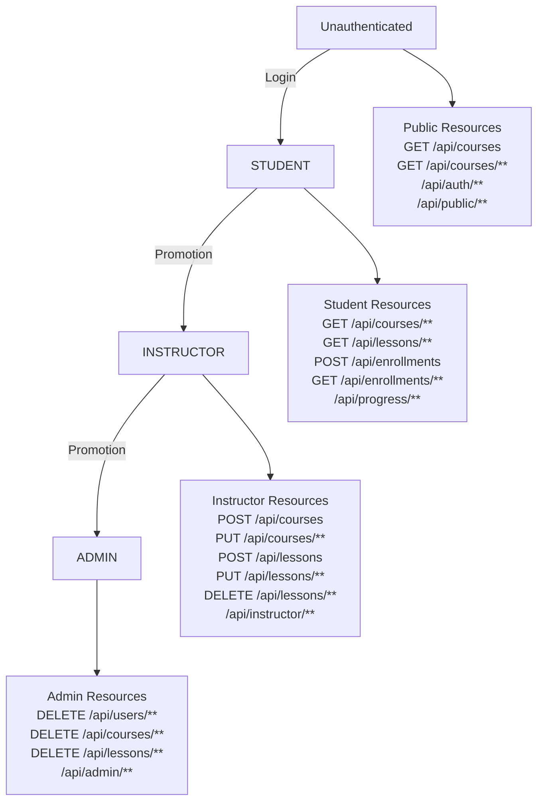
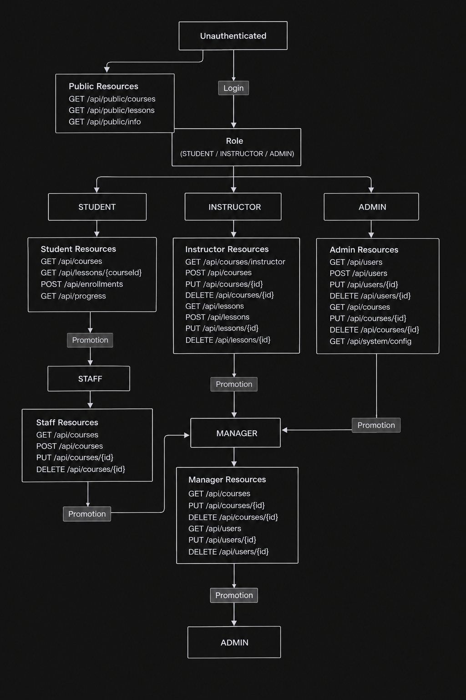

## Pengenalan

Pada langkah sebelumnya, kita telah mengimplementasikan endpoint untuk autentikasi dan mendapatkan token JWT. Namun, kita belum menerapkan otorisasi berbasis peran (Role-Based Access Control) pada endpoint aplikasi. Pada langkah ini, kita akan mengkonfigurasi akses ke endpoint berdasarkan peran pengguna.

## Konsep Role-Based Access Control (RBAC)

Role-Based Access Control (RBAC) adalah pendekatan otorisasi yang membatasi akses sistem berdasarkan peran pengguna. Implementasi RBAC melibatkan:

1. **Roles (Peran)** - Kumpulan izin yang diberikan kepada pengguna (mis. ADMIN, INSTRUCTOR, STUDENT)
2. **Permissions (Izin)** - Hak untuk melakukan tindakan tertentu (mis. READ, WRITE, DELETE)
3. **Users (Pengguna)** - Pengguna sistem yang diberi satu atau lebih peran

### Struktur Role di Spring Security

Dalam Spring Security, role direpresentasikan oleh GrantedAuthority. Secara konvensi, nama role didahului dengan "ROLE_" (mis. ROLE_ADMIN, ROLE_USER).

### Otorisasi di Multiple Level

Spring Security mendukung otorisasi di beberapa level:

1. **URL-level security** - Membatasi akses ke URL tertentu
2. **Method-level security** - Membatasi akses ke method tertentu
3. **Domain object security** - Membatasi akses ke objek tertentu

Pada modul ini, kita akan fokus pada URL-level security.

## Hands-on: Implementasi Role-Based Access Control

### Langkah 1: Update SecurityConfig untuk Role-Based URLs

Kita akan memperbarui `SecurityConfig` untuk menerapkan aturan akses berdasarkan peran:

```java
.authorizeHttpRequests((auth) -> auth
                // Public endpoints
                .requestMatchers("/api/auth/**").permitAll()
                .requestMatchers("/api/public/**").permitAll()
                
                // Admin-only endpoints
                .requestMatchers("/api/admin/**").hasRole("ADMIN")

                // Instructor endpoints
                .requestMatchers("/api/instructor/**").hasAnyRole("ADMIN", "INSTRUCTOR")
                        .anyRequest()
                        .authenticated());
```

### Langkah 2: Buat Controller untuk Demo Akses Berbasis Role

Mari kita buat controller sederhana untuk mendemonstrasikan akses berbasis role:

```java
package com.enigmacamp.enigmaCademy.controller;

import com.enigmacamp.enigmaCademy.dto.response.CommonResponse;
import com.enigmacamp.enigmaCademy.util.ResponseUtil;
import org.springframework.http.HttpStatus;
import org.springframework.http.ResponseEntity;
import org.springframework.security.core.Authentication;
import org.springframework.security.core.context.SecurityContextHolder;
import org.springframework.web.bind.annotation.GetMapping;
import org.springframework.web.bind.annotation.RequestMapping;
import org.springframework.web.bind.annotation.RestController;

@RestController
@RequestMapping("/api")
public class RoleBasedController {

    @GetMapping("/public/resource")
    public ResponseEntity<CommonResponse<String>> publicResource() {
        return ResponseUtil.buildResponse(
                HttpStatus.OK,
                "Ini adalah resource publik",
                "Siapapun bisa mengakses endpoint ini tanpa autentikasi."
        );
    }

    @GetMapping("/user-info")
    public ResponseEntity<CommonResponse<String>> userInfo() {
        Authentication auth = SecurityContextHolder.getContext().getAuthentication();

        String authorities = auth.getAuthorities().toString();

        return ResponseUtil.buildResponse(
                HttpStatus.OK,
                "Info pengguna terautentikasi",
                "Username: " + auth.getName() + ", Roles: " + authorities
        );
    }

    @GetMapping("/admin/resource")
    public ResponseEntity<CommonResponse<String>> adminResource() {
        return ResponseUtil.buildResponse(
                HttpStatus.OK,
                "Ini adalah resource admin",
                "Hanya pengguna dengan role ADMIN yang bisa mengakses endpoint ini."
        );
    }

    @GetMapping("/instructor/resource")
    public ResponseEntity<CommonResponse<String>> instructorResource() {
        return ResponseUtil.buildResponse(
                HttpStatus.OK,
                "Ini adalah resource instructor",
                "Pengguna dengan role ADMIN atau INSTRUCTOR yang bisa mengakses endpoint ini."
        );
    }

    @GetMapping("/student/resource")
    public ResponseEntity<CommonResponse<String>> studentResource() {
        return ResponseUtil.buildResponse(
                HttpStatus.OK,
                "Ini adalah resource student",
                "Pengguna dengan role ADMIN, INSTRUCTOR, atau STUDENT yang bisa mengakses endpoint ini."
        );
    }
}
```

### Langkah 3: Menerapkan Pembatasan di Controller yang Ada

Update controller yang ada (misalnya `CourseController`) untuk mengorganisasikan endpoint sesuai dengan struktur akses:

```java
// Contoh endpoint di CourseController yang sudah diorganisasi

// Publik - Semua orang bisa akses
@GetMapping
public ResponseEntity<CommonResponse<List<CourseResponse>>> getAllCourse() {
    // ...
}

// Hanya ADMIN & INSTRUCTOR yang bisa membuat Course baru
@PostMapping
public ResponseEntity<CommonResponse<CourseResponse>> createCourse(@RequestBody CourseRequest request) {
    // ...
}

// Hanya ADMIN & INSTRUCTOR yang bisa update menu
@PutMapping("/{id}")
public ResponseEntity<CommonResponse<CourseResponse>> updateCourse(@PathVariable String id, @RequestBody CourseRequest request) {
    // ...
}

// Hanya ADMIN yang bisa hapus menu
@DeleteMapping("/{id}")
public ResponseEntity<CommonResponse<String>> deleteCourse(@PathVariable String id) {
    // ...
}
```

## Penjelasan Aturan Akses

Berikut adalah penjelasan aturan akses yang diterapkan:

### 1. Public Resources

```text
.requestMatchers("/api/auth/**").permitAll()
.requestMatchers("/api/public/**").permitAll()
.requestMatchers(HttpMethod.GET, "/api/users/**").permitAll()
```

- Endpoint autentikasi dapat diakses siapa saja tanpa login
- Endpoint publik dapat diakses tanpa autentikasi
- GET request ke endpoint menu dapat diakses oleh siapa saja

### 2. Admin-Only Resources

```java
.requestMatchers("/api/admin/**").hasRole("ADMIN")
.requestMatchers(HttpMethod.DELETE, "/api/users/**")
    .hasRole("ADMIN")
.requestMatchers(HttpMethod.DELETE, "/api/courses/**")
    .hasRole("ADMIN")
.requestMatchers(HttpMethod.DELETE, "/api/lessons/**")
    .hasRole("ADMIN")
```

- Endpoint di bawah `/api/admin/**` hanya dapat diakses oleh `ADMIN`
- Penghapusan user hanya dapat dilakukan oleh `ADMIN`
- Penghapusan course hanya dapat dilakukan oleh `ADMIN`
- Penghapusan lesson hanya dapat dilakukan oleh `ADMIN`

### 3. Instructor Resources

```java
.requestMatchers("/api/instructor/**")
    .hasAnyRole("ADMIN", "INSTRUCTOR")
.requestMatchers(HttpMethod.POST, "/api/courses")
    .hasAnyRole("ADMIN", "INSTRUCTOR")
.requestMatchers(HttpMethod.PUT, "/api/courses/**")
    .hasAnyRole("ADMIN", "INSTRUCTOR")
.requestMatchers(HttpMethod.POST, "/api/lessons")
    .hasAnyRole("ADMIN", "INSTRUCTOR")
.requestMatchers(HttpMethod.PUT, "/api/lessons/**")
    .hasAnyRole("ADMIN", "INSTRUCTOR")
.requestMatchers(HttpMethod.DELETE, "/api/lessons/**")
    .hasAnyRole("ADMIN", "INSTRUCTOR")
```

- Endpoint di bawah `/api/instructor/**` dapat diakses oleh `INSTRUCTOR` dan `ADMIN`
- `INSTRUCTOR` dapat membuat course
- `INSTRUCTOR` dapat memperbarui course
- `INSTRUCTOR` dapat membuat lesson
- `INSTRUCTOR` dapat memperbarui lesson
- `INSTRUCTOR` dapat menghapus lesson
- `ADMIN` memiliki akses terhadap seluruh resource instructor

> **Catatan:** Role hanya menentukan apakah user boleh mengakses endpoint.
> Untuk memastikan instructor hanya dapat mengubah course/lesson miliknya sendiri,
> pengecekan ownership tetap dilakukan di service layer.

Contoh:

```text
INSTRUCTOR
    │
    ├── Course A ← boleh edit
    ├── Course B ← boleh edit
    │
    └── Course C milik Instructor lain ← tidak boleh edit
```

### 4. Student Resources

```java
.requestMatchers(HttpMethod.GET, "/api/courses/**")
    .hasAnyRole("ADMIN", "INSTRUCTOR", "STUDENT")
.requestMatchers(HttpMethod.GET, "/api/lessons/**")
    .hasAnyRole("ADMIN", "INSTRUCTOR", "STUDENT")
.requestMatchers(HttpMethod.POST, "/api/enrollments")
    .hasRole("STUDENT")
.requestMatchers(HttpMethod.GET, "/api/enrollments/**")
    .hasAnyRole("ADMIN", "INSTRUCTOR", "STUDENT")
.requestMatchers("/api/progress/**")
    .hasRole("STUDENT")
```

- Semua authenticated user dapat melihat course
- Semua authenticated user dapat melihat lesson
- `STUDENT` dapat melakukan enrollment ke course
- `STUDENT` dapat melihat enrollment miliknya
- `STUDENT` dapat mengelola progress belajarnya

> **Catatan:** Jika endpoint `/api/enrollments/**` juga digunakan oleh
> instructor/admin untuk melihat data enrollment, authorization perlu dibuat
> lebih spesifik berdasarkan HTTP method dan ownership.

### 5. Authenticated Resources

```java
.anyRequest().authenticated()
```

Semua endpoint yang tidak secara eksplisit didefinisikan sebagai `permitAll()`
atau memiliki aturan role tertentu harus membutuhkan authentication.


## Hirarki Akses

Hirarki akses yang diimplementasikan:

- **ADMIN**: memiliki akses penuh terhadap seluruh resource
- **INSTRUCTOR**: dapat mengelola course dan lesson, tetapi tidak dapat mengelola user atau melakukan operasi khusus admin
- **STUDENT**: dapat melihat course/lesson, melakukan enrollment, dan mengelola progress belajar sendiri


Diagram hirarki role:



### Ringkasan Permission

| Resource | STUDENT | INSTRUCTOR | ADMIN |
|---|---:|---:|---:|
| View courses | ✅ | ✅ | ✅ |
| View lessons | ✅ | ✅ | ✅ |
| Enrollment | ✅ | ❌ | ❌ |
| Manage own progress | ✅ | ❌ | ❌ |
| Create course | ❌ | ✅ | ✅ |
| Update course | ❌ | ✅* | ✅ |
| Create lesson | ❌ | ✅ | ✅ |
| Update lesson | ❌ | ✅* | ✅ |
| Delete lesson | ❌ | ✅* | ✅ |
| Delete course | ❌ | ❌ | ✅ |
| Manage users | ❌ | ❌ | ✅ |
| `/api/admin/**` | ❌ | ❌ | ✅ |
| `/api/instructor/**` | ❌ | ✅ | ✅ |

`*` Instructor hanya boleh mengubah resource yang menjadi tanggung jawab/miliknya.
Pengecekan ownership dilakukan di service layer, bukan hanya melalui `hasRole()`.



## Pengujian Role-Based Access

### 1. Registrasi User dengan Role Berbeda

**Admin User:**

```text
POST /api/auth/register
{
    "username": "admin",
    "email": "admin@enigmacademy.com",
    "password": "password123",
    "fullName": "Admin User",
    "role": "ADMIN"
}
```

**Instructor User:**

```text
POST /api/auth/register
{
    "username": "instructor",
    "email": "instructor@enigmacademy.com",
    "password": "password123",
    "fullName": "Instructor User",
    "role": "INSTRUCTOR"
}
```

**Student User :**

```text
POST /api/auth/register
{
    "username": "student",
    "email": "student@student.enigmacademy.com",
    "password": "password123",
    "fullName": "Student User",
    "roles": "STUDENT"
}
```

2. Login dan Dapatkan Token JWT

```text
POST /api/auth/login
{
    "username": "admin",
    "password": "password123"
}
```

### 3. Uji Akses dengan Role Berbeda

1. **Akses dengan Admin Token**
    - Seharusnya bisa mengakses semua endpoint
2. **Akses dengan Instructor Token**
    - Bisa mengakses `/api/instructor/**`
    - Bisa membuat dan update menu
    - Tidak bisa menghapus menu
3. **Akses dengan Student Token**
    - Bisa melihat semua pesanan
    - Bisa mengubah status pesanan
    - Tidak bisa membuat atau update menu
4. **Akses dengan Customer Token**
    - Bisa membuat pesanan
    - Bisa melihat menu
    - Tidak bisa mengakses `/api/instructor/**` atau `/api/admin/**`

## Model Keamanan untuk Aplikasi LMS

Berikut adalah model keamanan lengkap untuk aplikasi **LMS (Learning Management System) Sederhana**:

### 1. Public Access

Resource yang dapat diakses tanpa login:

- View daftar course
- View informasi course
- View informasi lesson
- Register
- Login

### 2. Student Access

Student memiliki akses sebagai user yang telah login:

- View course
- View detail course
- View lesson
- Enroll ke course
- View course yang diikuti
- View progress belajar
- Update own profile

**Student tidak dapat mengakses:**

- `/api/instructor/**`
- `/api/admin/**`

### 3. Instructor Access (includes Student access)

Instructor memiliki seluruh akses Student, ditambah:

- Create course
- Update own course
- Delete own course
- Manage lesson pada course yang dimiliki
- Create lesson
- Update lesson
- Delete lesson
- View student yang mengikuti course miliknya

**Instructor tidak dapat mengakses:**

- `/api/admin/**`

### 4. Admin Access (includes Instructor access)

Admin memiliki seluruh akses Instructor, ditambah:

- Manage all courses
- Manage all lessons
- Manage users
- Manage students
- Manage instructors
- Delete any resource
- View system information
- System configuration

## Implementasi Lanjutan: Owner-Based Access

Untuk implementasi lebih lanjut, kita bisa menambahkan owner-based access control, di mana pengguna hanya bisa mengakses resource yang mereka miliki. Misalnya, customer hanya bisa melihat dan mengedit pesanan mereka sendiri.

Ini tidak diimplementasikan dalam modul ini, tetapi bisa menjadi pengembangan selanjutnya.

## Langkah Selanjutnya

Pada langkah berikutnya kita akan:

1. Mengimplementasikan CORS untuk integrasi dengan frontend
2. Menambahkan security headers untuk protection tambahan
3. Meningkatkan error handling untuk security exceptions

## Latihan

1. Implementasikan custom permission evaluator untuk owner-based access control
2. Tambahkan role "MANAGER" yang hanya bisa mengakses dan mengupdate beberapa resource tertentu
3. Implementasikan hirarki role dimana ADMIN secara otomatis memiliki semua izin INSTRUCTOR

## Referensi

1. [Spring Security Authorization](https://docs.spring.io/spring-security/reference/servlet/authorization/index.html)
2. [Role-Based Access Control](https://en.wikipedia.org/wiki/Role-based_access_control)
3. [Security Best Practices](https://owasp.org/www-project-top-ten/)
4. [Spring Security Architecture](https://spring.io/guides/topicals/spring-security-architecture)