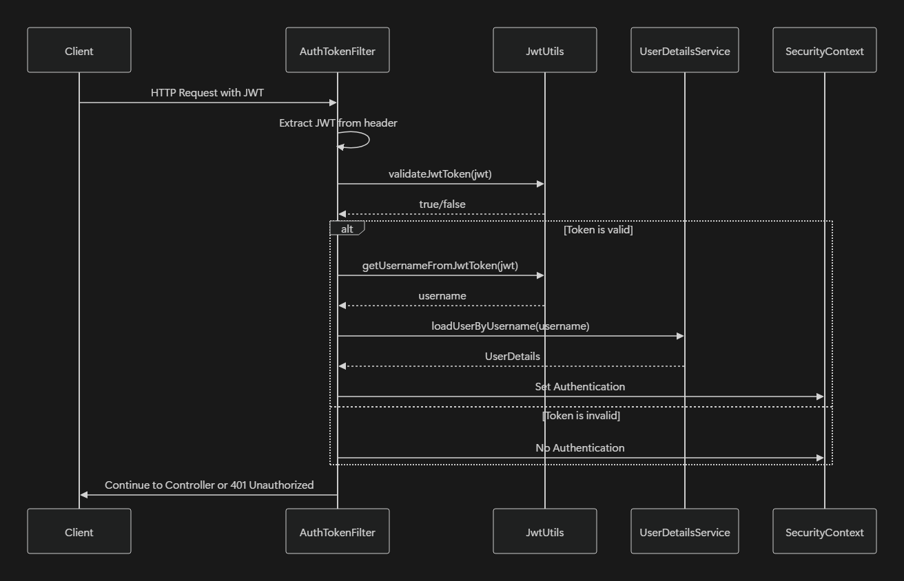

## Pengenalan

Pada branch sebelumnya, kita telah mengimplementasikan `JwtUtils` untuk membuat, memvalidasi, dan memproses token JWT. Namun, kita belum mengintegrasikan JWT ke dalam alur autentikasi Spring Security. Pada branch ini, kita akan mengimplementasikan filter yang akan memeriksa dan memproses token JWT untuk setiap request yang masuk.

## Konsep Filter dalam Spring Security

Spring Security bekerja dengan serangkaian filter yang dijalankan dalam urutan tertentu. Setiap request HTTP yang masuk akan melewati filter-filter ini sebelum mencapai endpoint yang diminta.

Filter yang akan kita implementasikan, `AuthTokenFilter`, akan ditempatkan sebelum `UsernamePasswordAuthenticationFilter` dalam filter chain. Tujuannya adalah untuk memeriksa apakah request mengandung token JWT yang valid, dan jika iya, mengatur autentikasi dalam `SecurityContext`.

## Hands-on: Implementasi JWT Filter dan Exception Handling

### Langkah 1: Buat AuthEntryPointJwt

Pertama, kita perlu membuat komponen untuk menangani exception saat autentikasi gagal:

```java
package com.enigmacamp.enigmaCademy.security.jwt;

import com.enigmacamp.enigmaCademy.dto.response.CommonResponse;
import jakarta.servlet.ServletException;
import jakarta.servlet.http.HttpServlet;
import jakarta.servlet.http.HttpServletRequest;
import jakarta.servlet.http.HttpServletResponse;
import lombok.extern.slf4j.Slf4j;
import org.springframework.http.HttpStatus;
import org.springframework.http.MediaType;
import org.springframework.security.core.AuthenticationException;
import org.springframework.security.web.AuthenticationEntryPoint;
import org.springframework.stereotype.Component;
import tools.jackson.databind.ObjectMapper;

import java.awt.*;
import java.io.IOException;

@Component
@Slf4j
public class AuthEntryPointJwt implements AuthenticationEntryPoint {

    @Override
    public void commence(HttpServletRequest request, HttpServletResponse response, AuthenticationException authException) throws IOException {
        // print error jika ada unauthorized error
        log.error("Unauthorized error : " + authException.getMessage());

        // set response
        response.setContentType(MediaType.APPLICATION_JSON_VALUE);
        response.setStatus(HttpServletResponse.SC_UNAUTHORIZED);

        CommonResponse<Object> errorResponse = CommonResponse.builder()
                .statusCode(HttpStatus.UNAUTHORIZED.value())
                .message("Unauthorized + " + authException.getMessage())
                .build();

        final ObjectMapper mapper = new ObjectMapper();

        mapper.writeValue(response.getOutputStream(), errorResponse);
    }
}
```

### Langkah 2: Implementasikan AuthTokenFilter

Sekarang, kita akan membuat filter yang akan memeriksa dan memproses token JWT:

```java
package com.enigmacamp.enigmaCademy.security.jwt;

import com.enigmacamp.enigmaCademy.security.service.CustomUserDetailsService;
import jakarta.servlet.FilterChain;
import jakarta.servlet.ServletException;
import jakarta.servlet.http.HttpServletRequest;
import jakarta.servlet.http.HttpServletResponse;
import lombok.RequiredArgsConstructor;
import lombok.extern.slf4j.Slf4j;
import org.springframework.security.authentication.UsernamePasswordAuthenticationToken;
import org.springframework.security.core.context.SecurityContextHolder;
import org.springframework.security.core.userdetails.UserDetails;
import org.springframework.security.web.authentication.WebAuthenticationDetailsSource;
import org.springframework.stereotype.Component;
import org.springframework.util.StringUtils;
import org.springframework.web.filter.OncePerRequestFilter;

import java.io.IOException;

@Component
@Slf4j
@RequiredArgsConstructor
public class AuthTokenFilter extends OncePerRequestFilter {
    private final JwtUtils jwtUtils;
    private final CustomUserDetailsService userDetailsService;

    @Override
    protected void doFilterInternal(HttpServletRequest request, HttpServletResponse response, FilterChain filterChain) throws ServletException, IOException {
        try {
            String jwt = parseJwt(request);

            if(jwt != null && jwtUtils.validateJwtToken(jwt)) {
                String username = jwtUtils.getUsernameFromJwtToken(jwt);

                // cara 1 : mendapatkan UserDetails dari database atau loadUserByUsername yang ada di service
                UserDetails userDetails = userDetailsService.loadUserByUsername(username);

                // cara 2 : mendapatkan user details dari jwt
                // a. get role dari jwt
//                String role = jwtUtils.getRoleFromJwtToken(jwt);
//                UserDetails userDetails1 = new User(
//                        username,
//                        "",
//                        Collections.singleton(new SimpleGrantedAuthority(role))
//                );

                UsernamePasswordAuthenticationToken authentication = new UsernamePasswordAuthenticationToken(
                        userDetails,
                        null,
                        userDetails.getAuthorities());

                authentication.setDetails(new WebAuthenticationDetailsSource().buildDetails(request));

                SecurityContextHolder.getContext().setAuthentication(authentication);
            }
        }catch (Exception e) {
            log.error("Cannot set user authentication : " + e.getMessage());
        }

        filterChain.doFilter(request, response);
    }

    private String parseJwt(HttpServletRequest request) {
        String headerAuth = request.getHeader("Authorization");

        if(StringUtils.hasText(headerAuth) && headerAuth.startsWith("Bearer ")) { // Bearer hasgdhgsadasgdjhagsdja
            return headerAuth.substring(7);
        }
        return null;
    }
}
```

### Langkah 3: Update SecurityConfig untuk JWT Authentication

Sekarang, kita perlu memperbarui konfigurasi security untuk menggunakan JWT:

```java
package com.enigmacamp.enigmaCademy.config;

import com.enigmacamp.enigmaCademy.security.jwt.AuthTokenFilter;
import lombok.RequiredArgsConstructor;
import org.springframework.context.annotation.Bean;
import org.springframework.context.annotation.Configuration;
import org.springframework.security.authentication.AuthenticationManager;
import org.springframework.security.authentication.dao.DaoAuthenticationProvider;
import org.springframework.security.config.annotation.authentication.configuration.AuthenticationConfiguration;
import org.springframework.security.config.annotation.web.builders.HttpSecurity;
import org.springframework.security.config.annotation.web.configuration.EnableWebSecurity;
import org.springframework.security.config.annotation.web.configurers.AbstractHttpConfigurer;
import org.springframework.security.config.http.SessionCreationPolicy;
import org.springframework.security.core.userdetails.UserDetailsService;
import org.springframework.security.crypto.bcrypt.BCryptPasswordEncoder;
import org.springframework.security.crypto.password.PasswordEncoder;
import org.springframework.security.web.AuthenticationEntryPoint;
import org.springframework.security.web.SecurityFilterChain;
import org.springframework.security.web.access.AccessDeniedHandler;
import org.springframework.security.web.authentication.UsernamePasswordAuthenticationFilter;

@Configuration
@EnableWebSecurity
@RequiredArgsConstructor
public class SecurityConfig {
    private final UserDetailsService userDetailsService;
    private final AuthenticationEntryPoint authenticationEntryPoint;
    private final AccessDeniedHandler accessDeniedHandler;
    private final AuthTokenFilter authTokenFilter;

    @Bean
    public SecurityFilterChain securityFilterChain(HttpSecurity http) throws Exception {
        http
                .csrf(AbstractHttpConfigurer::disable)
                .exceptionHandling(ex -> ex
                        .authenticationEntryPoint(authenticationEntryPoint)
                        .accessDeniedHandler(accessDeniedHandler))
                .sessionManagement(s -> s.sessionCreationPolicy(SessionCreationPolicy.STATELESS))
                .authorizeHttpRequests((auth) -> auth
                        .requestMatchers("/api/v1/auth/**").permitAll()
                        .requestMatchers("/api/v1/users/**").hasRole("ADMIN")
                        .anyRequest()
                        .authenticated());

        http.authenticationProvider(authenticationProvider());

        http.addFilterBefore(authTokenFilter, UsernamePasswordAuthenticationFilter.class);
        return http.build();
    }

    @Bean
    public DaoAuthenticationProvider authenticationProvider() {
        DaoAuthenticationProvider authProvider = new DaoAuthenticationProvider(userDetailsService);

        authProvider.setPasswordEncoder(passwordEncoder());
        return authProvider;
    }

    @Bean
    public AuthenticationManager authenticationManager(AuthenticationConfiguration authConfig) throws Exception {
        return authConfig.getAuthenticationManager();
    }

    @Bean
    public PasswordEncoder passwordEncoder() {
        return new BCryptPasswordEncoder();
    }


}
```

## Penjelasan Kode

### 1. AuthEntryPointJwt

`AuthEntryPointJwt` mengimplementasikan interface `AuthenticationEntryPoint` dari Spring Security, yang:

- Dipanggil ketika autentikasi gagal dan exception `AuthenticationException` dilempar
- Mengembalikan respons HTTP dengan status 401 (Unauthorized)
- Menggunakan format respons JSON yang konsisten dengan format respons API kita

### 2. AuthTokenFilter

`AuthTokenFilter` mengextend `OncePerRequestFilter` dari Spring, yang:

- Memastikan filter dijalankan hanya sekali per request
- Mengekstrak token JWT dari header Authorization
- Memvalidasi token JWT menggunakan `JwtUtils`
- Mengambil username dan roles dari token
- Membuat objek autentikasi dan menyimpannya di `SecurityContext`

Ada dua pendekatan yang bisa digunakan untuk membuat UserDetails:

1. **Option 1**: Memuat UserDetails dari database - Lebih aman karena mengecek apakah user masih valid
2. **Option 2**: Membuat UserDetails dari JWT claims - Lebih cepat karena tidak perlu query database

### 3. SecurityConfig Updates

Perubahan utama pada `SecurityConfig` meliputi:

- Penggunaan `SessionCreationPolicy.STATELESS` karena JWT tidak menggunakan session
- Penambahan `AuthEntryPointJwt` untuk menangani exception autentikasi
- Penambahan `AuthTokenFilter` ke filter chain sebelum `UsernamePasswordAuthenticationFilter`
- Ekspos `AuthenticationManager` sebagai bean untuk digunakan nanti pada controller autentikasi

## Alur Kerja Autentikasi JWT

```text
sequenceDiagram
    participant Client
    participant Filter as AuthTokenFilter
    participant JwtUtils
    participant UserDetailsService
    participant SecurityContext

    Client->>Filter: HTTP Request with JWT
    Filter->>Filter: Extract JWT from header
    Filter->>JwtUtils: validateJwtToken(jwt)
    JwtUtils-->>Filter: true/false

    alt Token is valid
        Filter->>JwtUtils: getUsernameFromJwtToken(jwt)
        JwtUtils-->>Filter: username
        Filter->>UserDetailsService: loadUserByUsername(username)
        UserDetailsService-->>Filter: UserDetails
        Filter->>SecurityContext: Set Authentication
    else Token is invalid
        Filter->>SecurityContext: No Authentication
    end

    Filter->>Client: Continue to Controller or 401 Unauthorized
```



## Pengujian Filter

Kita masih belum bisa sepenuhnya menguji autentikasi JWT karena kita memerlukan controller untuk login dan mendapatkan token. Pengujian untuk filter akan kita lakukan setelah mengimplementasikan endpoint autentikasi pada modul berikutnya.

Setelah implementasi lengkap, kita dapat menggunakan tools seperti Postman atau cURL untuk menguji alur autentikasi JWT secara menyeluruh.

## Keamanan dan Praktik Terbaik

### 1. Token Management

- Gunakan waktu kedaluwarsa token yang wajar (tidak terlalu lama, tidak terlalu singkat)
- Pertimbangkan implementasi token refresh untuk meningkatkan keamanan
- Simpan token di tempat yang aman di sisi client (HttpOnly cookies, secure storage)

### 2. Error Handling

- Jangan mengungkapkan terlalu banyak detail dalam pesan error
- Log secara komprehensif untuk troubleshooting di sisi server
- Berikan respons error yang konsisten

### 3. Security Headers

- Gunakan Security Headers seperti:
    - Content-Security-Policy
    - X-Content-Type-Options
    - X-Frame-Options
    - X-XSS-Protection

## Langkah Selanjutnya

Pada branch berikutnya kita akan:
1. Mengimplementasikan controller dan service untuk autentikasi
2. Membuat endpoint untuk login dan mendapatkan token
3. Membuat endpoint untuk registrasi user baru

## Latihan

1. Modifikasi `AuthTokenFilter` untuk mendukung token refresh
2. Tambahkan logging komprehensif untuk setiap tahap pemrosesan token
3. Implementasikan token blacklist untuk mencabut token sebelum waktu kedaluwarsa
4. Ubah format respons error untuk menyertakan lebih banyak informasi (tanpa mengekspos detail sensitif)

## Referensi

1. [Spring Security Documentation]((https://docs.spring.io/spring-security/reference/servlet/architecture.html#servlet-security-filters))
2. [OncePerRequestFilter in Spring](https://www.baeldung.com/spring-onceperrequestfilter)
3. [Spring Security Authentication Architecture](https://docs.spring.io/spring-security/reference/servlet/authentication/architecture.html)
4. [Exception Handling in Spring Security](https://www.baeldung.com/spring-security-exceptionhandler)
